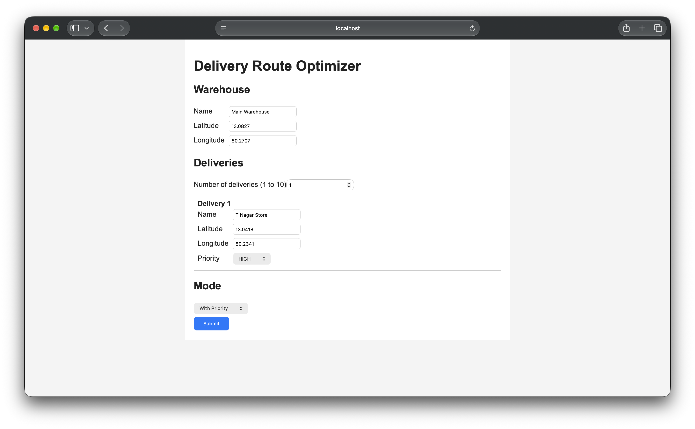

Delivery Route Optimizer

A small web app that plans a delivery route. You enter a warehouse and up to 10
delivery stops (each with a priority), and the app tells you the order to visit
them in. The route starts and ends at the warehouse, and you can see the distance
of every leg.

I built it for a technical assessment. The part I paid most attention to was the
reasoning behind the route and handling the awkward inputs properly, so there is
a separate `APPROACH.md` that explains my decisions.

**Live demo:** <add the frontend link here>
**API docs:** <add the backend link here>/docs

The app is on free hosting, so the first request after a quiet period can take
up to a minute while the server wakes up.

What it does :

1.Takes a warehouse and 1 to 10 deliveries (name, latitude, longitude, priority).
2.Two modes: Without Priority (shortest total distance) and With Priority(important deliveries are reached earlier, even if the route gets a bit longer).
3.Shows the visiting order, the distance of each leg, the total distance, and a simple node-and-edge diagram.
4.Saves every successful result in a PostgreSQL table called `routes`.

The distances are straight-line (Haversine) distances, not road distances. The
diagram is only a schematic, it is not drawn from the real coordinates.


Tech stack :

1.Backend: Python, FastAPI
2.Frontend: React (Vite)
3.Database: PostgreSQL
4.Tests: pytest
5.Hosting: Render

How the route is made (short version)

1. Work out the distance between every pair of places with the Haversine formula.
2. Build a first route with Nearest Neighbour.
3. Improve it with 2-Opt, using the same cost the mode cares about.

The details and the reasons are in `APPROACH.md`. This is a heuristic, so it gives
a good route quickly but I do not claim it is always the best possible one.

Running it on your own computer

You need Python 3, Node.js and PostgreSQL.

1. Database

```bash
psql postgres -c "CREATE DATABASE route_optimizer;"
```

The `routes` table is created automatically the first time a route is saved.

2. Settings

Copy `.env.example` to `.env` and put your own username in it:

```
DATABASE_URL=postgresql://your-username@localhost:5432/route_optimizer
```

The `.env` file is in `.gitignore`, so it never gets uploaded.

3. Backend

```bash
python3 -m venv venv
source venv/bin/activate
pip install -r backend/requirements.txt
python -m uvicorn backend.main:app --reload
```

The API runs on http://127.0.0.1:8000 and the docs are at http://127.0.0.1:8000/docs.

4. Frontend** (in a second terminal)

```bash
cd frontend
npm install
npm run dev
```

Open http://localhost:5173.

Using the API directly

`POST /optimize` with JSON like the one in `data/sample_data.json`:

```json
{
  "warehouse": {"name": "Main Warehouse", "latitude": 13.0827, "longitude": 80.2707},
  "deliveries": [
    {"name": "T Nagar Store", "latitude": 13.0418, "longitude": 80.2341, "priority": "HIGH"}
  ],
  "use_priority": true
}
```

The answer contains the ordered stops, the legs with their distances, the total
distance, and whether the route was saved. Bad input gets a `400` with a list of
readable messages.

Tests

```bash
python -m pytest -v
```

There are 46 tests. They cover the distance calculation, the distance table, the
route rules (starts and ends at the warehouse, every delivery visited once),
2-Opt, both priority modes, input validation and the database failure case.

The tests use a fake `save_route`, so they do not touch a real database. Saving
to PostgreSQL I checked by hand.

Edge cases I handled :

- 0 deliveries: rejected with a message (there is nothing to optimise).
- 1 delivery: works, route is warehouse, stop, warehouse.
- More than 10 deliveries: rejected.
- Missing or invalid latitude and longitude, or values outside the allowed range.
- Missing name or an unknown priority.
- Two deliveries at the same coordinates: both are kept as separate stops.
- A delivery at the same place as the warehouse: allowed, distance is 0.
- Broken or malformed requests.
- Database problems: the route is still returned, but the response clearly says it
  was not saved.

Limitations :

- Straight-line distance, not road distance.
- Nearest Neighbour plus 2-Opt can get stuck on a route that is good but not the
  best possible.
- The priority weights (4, 2, 1) are my own choice, not something proven.
- On free hosting the app can be slow on the first request.

Project structure :

```
backend/        FastAPI app and the algorithm (main.py)
frontend/       React app (index page and result page)
data/           sample input
tests/          pytest tests
screenshots/    screenshots of the app
APPROACH.md     reasoning and decisions
```

Screenshots :




